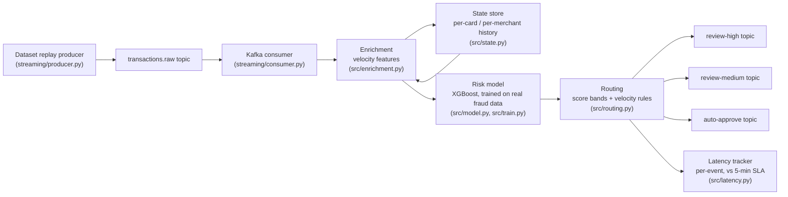

# Real-Time Transaction Risk Scoring — Kafka Enrichment, Scoring & Queue Routing

**A streaming pipeline that enriches every transaction with velocity features, scores it for fraud risk, and routes it to the right investigation queue — built against a 5-minute delivery SLA, and measured end-to-end.**

This project recreates, as runnable code, the streaming risk-scoring work from
my time as a Data Scientist at Mphasis: Kafka producer–consumer workflows for
transaction enrichment and risk scoring that delivered processed indicators to
downstream investigation queues within 5 minutes of event publication. The
5 minutes is the production SLA; the latency this code actually achieves is
measured and reported below — not asserted.

---

## Architecture



The core (`src/`) has **no Kafka dependency**: the consumer, the tests, and
the replay benchmark all call the same `StreamingPipeline.process()` —
enrich → score → route — so what is benchmarked and tested is exactly what
runs against the broker.

### The pipeline, step by step

1. **Enrichment** (`src/enrichment.py`) — from the state store, compute
   per-card counts and amount sums over 10-minute / 1-hour / 24-hour windows,
   per-merchant counts, time since the card's last transaction, and amount
   deviation vs. the card's own history (ratio to mean and z-score). Windows
   look strictly backwards: an event never counts toward its own features.
2. **Scoring** (`src/model.py`) — an ML model trained on the real fraud
   dataset (below) returns a fraud probability for the transaction.
3. **Routing** (`src/routing.py`) — the score sets a band
   (≥ 0.80 high, ≥ 0.30 medium, else low), then velocity rules can
   **escalate** — never de-escalate — an event: ≥ 4 prior card transactions
   within 10 minutes, ≥ 10 within an hour, or an amount ≥ 5× the card's
   historical average (only for amounts ≥ $100 and only once the card has
   ≥ 5 prior transactions, so the "average" is a real baseline, not noise).
   Bands map to queues: `review-high`, `review-medium`, `auto-approve`.
   Every decision carries human-readable reasons for the investigator.
4. **Latency tracking** (`src/latency.py`) — every event's processing
   latency is recorded and summarized against the 5-minute SLA.

### State management

Velocity features need history. `src/state.py` defines a `StateStore`
protocol and an `InMemoryStateStore` (per-entity deques, lazily pruned to
the 24-hour window) used for local runs, the benchmark, and tests — no
external service required. In production the same interface is implemented
over **Redis** (one sorted set per entity, TTL = 24h; a `prod-state` profile
in `docker-compose.yml` runs it), because the in-memory store is per-process
and consumer instances must share state.

## The model

Trained on the **real** credit-card fraud dataset (284,807 transactions, 492
fraud — see [`data/README.md`](data/README.md)). Because this is a streaming
system, the split is **chronological** (train on the first 70% by time,
validate on the next 15%, test on the final 15%): the model is always
evaluated on its future, as in deployment. A logistic-regression baseline and
XGBoost were compared on validation PR-AUC; XGBoost won and was frozen.

Held-out **test period** results (threshold 0.5; full record in
[`reports/metrics.json`](reports/metrics.json)):

| Model | Precision | Recall | ROC-AUC | PR-AUC |
|---|---|---|---|---|
| Logistic Regression | 0.023 | 0.885 | 0.978 | 0.717 |
| **XGBoost (selected)** | **0.848** | **0.750** | **0.972** | **0.772** |

Two honest observations from these numbers: the baseline's 0.885 recall is
bought with 1,937 false positives (precision 0.023 — an unusable queue), and
both models score lower here than under a shuffled split (validation PR-AUC
was 0.859 for XGBoost) because the test period is the model's *future* and
fraud patterns drift across the two days. XGBoost was selected on validation
PR-AUC (0.859 vs. the baseline's 0.844).

Velocity features are deliberately **not** model inputs: the offline data
has no entity history, so training on replay-time velocity values would mean
training on synthetic-entity artifacts. Enrichment features instead inform
investigators and drive the routing escalation rules — the score-plus-rules
split used by real fraud stacks.

## Replay benchmark — measured latency

The benchmark replays the first 10,000 test-period transactions, in
chronological order, through the full pipeline (same code path as the Kafka
consumer) and measures per-event processing latency on this machine:

| Metric | Value |
|---|---|
| Events replayed | 10,000 |
| Mean latency | 2.64 ms |
| p50 | 0.94 ms |
| p95 | 9.56 ms |
| p99 | 26.75 ms |
| Max | 214.43 ms |
| Throughput | 332.9 events/s |
| Within the 5-minute SLA | 100% |

Routing outcome of the replay: 8,782 events (87.8%) were auto-approved,
1,199 (12.0%) went to `review-medium`, and 19 (0.2%) to `review-high`.
XGBoost's scores here are largely bimodal (near 0 or above 0.8), so the
medium band is in practice mostly a *velocity* band: 1,198 events were
escalated into review by the burst/amount rules. Of the 24 labeled frauds in
the replay window, 21 were routed to a review queue (87.5% capture) and 19
of them straight to `review-high`; 3 scored low with no velocity signal and
were auto-approved — the recall gap is reported, not hidden.

## Honesty notes — replay vs. live

- **This is a replay, not a live stream.** Dataset transactions are re-fed
  through the pipeline in order. The latency above is real measured
  *processing* latency (enrich + score + route, in-process); it does **not**
  include Kafka broker transit, network, or consumer-lag time. Against a
  5-minute SLA those add margin consumption, not a different order of
  magnitude — but they are not in this number, and this README doesn't
  pretend otherwise.
- **The dataset has no card/merchant IDs** (it is PCA-anonymized). The
  replay assigns synthetic, seeded, Zipf-distributed IDs purely so the
  velocity machinery has entities to work over (`src/events.py`). Velocity
  *values* in the replay therefore illustrate the mechanics; in production
  the events carry real identifiers.
- The chronological split makes the test metrics lower than a shuffled
  split would — fraud patterns drift over the two days, and the model is
  scored on a future it never saw. That is the honest number for a
  streaming deployment.
- **Rule calibration matters as much as model quality.** An early version of
  these routing rules (one low hourly threshold, plus an amount ratio
  computed against a single prior transaction) escalated ~59% of *all*
  traffic into the review queue — a queue no team can work. The shipped
  rules require a genuine burst, sustained volume, or a deviation against
  an established ≥ 5-transaction baseline; the replay review rate is 12.2%.

## Run it

```bash
pip install -r requirements.txt

# 1. Get the dataset (auto-downloads from a public mirror on first run,
#    or see data/README.md) and train the model
python -m src.train

# 2. Replay benchmark (no broker needed) — writes reports/metrics.json
python -m src.replay --limit 10000

# 3. Tests (no broker, no dataset needed)
pytest
```

### With Kafka (docker-compose)

```bash
docker compose up -d                 # Kafka + Zookeeper on localhost:9092
python -m streaming.consumer         # terminal 1: enrich/score/route, prints latency stats
python -m streaming.producer         # terminal 2: publishes transactions.raw
```

Topics: input `transactions.raw`; outputs `review-high`, `review-medium`,
`auto-approve` (auto-created on first publish).

## Project structure

```
realtime-transaction-risk-scoring/
├── src/
│   ├── events.py       # TransactionEvent / ScoredEvent, synthetic entity assignment
│   ├── state.py        # StateStore protocol + InMemoryStateStore (Redis in prod)
│   ├── enrichment.py   # velocity / context feature computation
│   ├── model.py        # RiskModel: training features, scoring, bundle save/load
│   ├── routing.py      # risk bands, queues, velocity escalation rules
│   ├── latency.py      # per-event latency tracker vs. the 5-minute SLA
│   ├── pipeline.py     # StreamingPipeline: enrich -> score -> route (Kafka-free)
│   ├── data.py         # dataset loading + chronological split
│   ├── train.py        # CLI: LR vs XGBoost comparison, saves bundle + metrics
│   └── replay.py       # CLI: replay benchmark, latency + routing metrics
├── streaming/
│   ├── producer.py     # Kafka producer: dataset -> transactions.raw
│   └── consumer.py     # Kafka consumer: pipeline -> queue topics
├── tests/              # enrichment math, windows, routing, latency, end-to-end
├── data/README.md      # dataset provenance + download
├── reports/metrics.json
├── docker-compose.yml  # Kafka (+ optional Redis state store profile)
├── requirements.txt
└── LICENSE             # MIT
```

## Origin

One of a series of projects rebuilding my professional work as open,
verifiable code — the model and dataset approach follow
[fraud-detection-ml](https://github.com/LakshmanYaganti/fraud-detection-ml);
this project adds the streaming layer that project deliberately left out.

## License

MIT — see [LICENSE](LICENSE). Copyright (c) 2026 Lakshman Sai Yaganti.
